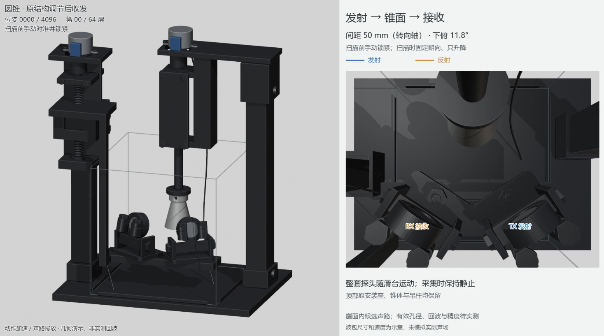
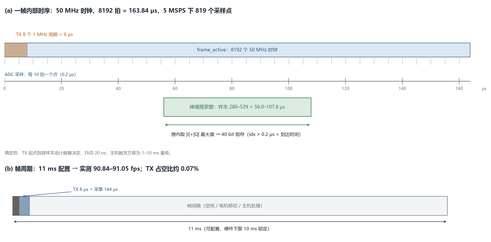

# 基于 AMD Zynq-7020 的实时超声三维扫描与形态异常检测系统

**设计报告**

| 项 | 内容 |
|---|---|
| 赛事 | 2026 全国大学生嵌入式芯片与系统设计竞赛 · FPGA 创新设计赛道 |
| 方向 | AMD 自主选题（初级组） |
| 平台 | 正点原子启明星 ZYNQ7020（XC7Z020CLG400-2I，PL 50 MHz） |
| 工具 | Vivado / Vitis 2025.1，Python 3.12+，Node.js（页面离线验收） |
| 版本 | v1.1 · 2026-10-30（与技术文档 v1.0 对齐） |
| 代码与证据 | 本交付包根目录；文件命名全英文，正文中文 |

> **一句话**：把一套原本依赖示波器/ILA 上传、在 PC 上离线处理的超声三维扫描流程，重构为“FPGA 确定性采集 + 板上定点 DSP 出结果 + PS 网页实时呈现 + 姿态交互”的闭环，并用可复现的证据链把每个数字的真实来源钉死。

---

## 摘要

超声三维成像能补充二维切面缺失的空间信息，但密集采集带来的数据量、实时处理压力和交互延迟，使纯 PC 方案难以同时做到低延迟、高吞吐和便携。本项目以 1 MHz 单阵元水浸超声、双轴机械扫描和 AMD Zynq-7020 为核心，构建了一套面向“回转体表面重建 + 形态异常比对”的原理验证平台。

FPGA 可编程逻辑承担三件对确定性要求最高的事：第一，发射、采样、电机与位姿在同一 50 MHz 时钟域内闭环，帧内 8192 拍、5 MSPS 双路采样，发射起点到首样本由计数器决定；第二，把 1 MHz 正交解调、包络和窗内峰值/质心做成流水线，每帧只回传 5 字节结果，替代每帧 342 KB 的 ILA 上传；第三，在 `capture_start` 上升沿硬件锁存两轴步数，使“这一帧对应哪一步”不再依赖主机时间戳。PS 侧以裸机 + lwIP 提供 `/state`、`/api/pose` 和静态页面，C 算法与 Python 参考逐字节一致；PC 侧完成标定、质量门、旋转体建模、残差聚类和离线报告。

实测结果：板上自主触发 90.84–91.05 fps，PS 连续读取 90.93 fps 且 `missed=0`；单帧结果回读 2.48–2.80 ms，相对 ILA 的 477–555 ms 提升 171–202 倍；三层与六层真实扫描分别得到 144 顶点/192 面、288 顶点/480 面的开放侧壁网格；MPU6050 姿态链路实测 716.6 Hz，网页 20 Hz 刷新，手转模块时模型同步旋转。四类标准件（圆柱、两种锥台、台阶轴）与凸起异常检测目前由 4096 点数字体模完成验证：半径 MAE 约 0.189 mm，8 个凸起全部命中、0 个误报格子；真实四件全高度扫描与真实凸起检出见演示视频。

**关键词**：超声三维重建；Zynq-7020；正交解调；峰值检测；AXI；姿态融合；可复现证据链

---

## 1. 选题背景与创新点

### 1.1 要解决的实际问题

医学超声依靠回波的时间与幅度获取组织界面信息。二维成像只给出一个切面，医生需要在脑中把多个切面拼成三维结构；三维超声则能直接给出空间形态，在术前评估、术中导航、穿刺引导和形态异常筛查中更有价值。但三维数据不是“多拍几张”那么简单：

- **采集端**：机械扫描需要把探头位置、发射时刻和采样窗口严格对齐，否则每个点都带着未知的几何误差；
- **数据端**：一帧原始波形动辄数百 KB，密集扫描时上传带宽和存储会成为瓶颈；
- **计算端**：滤波、解调、包络、找峰、标定、重建、配准逐级叠加，PC 上很难同时保证低延迟和高帧率；
- **交互端**：临床手术场景中医生双手被占用，若三维模型只能靠鼠标旋转，观测效率会明显下降；更关键的是，**如果无法控制物体旋转，就无法把标准物与待测物的差异定位到具体方位**——只能看到“有差异”，却说不清“差在哪个角度、哪个高度”。

本项目不声称替代临床设备，而是回答一个工程问题：**在低成本单阵元探头和中等规模 FPGA 上，能否把“采集—处理—重建—比对—交互”做成一条可测量、可复现、可解释的闭环？**

柔性压电换能器与专用超声前端在血流、肺音等方向已有研究[7-9]；本作品不研究换能器材料与声学设计，重点是把 1 MHz 单阵元水浸超声、机械扫描和 FPGA 实时处理连成可复现的闭环。

### 1.2 前人路线与不足

公开资料和商用产品主要有三条路线：

1. **矩阵阵列三维探头**：在探头内集成二维面阵，通过电子扫描直接获得体数据。成像快、无机械运动，但通道数、前端功耗和成本都很高，不适合作为低成本教学/科研平台。
2. **机械扫描三维探头**：用电机带动单阵元或一维阵列做扇形/平移扫描，成本低，但机械回差、线缆扭动和开环步进会引入几何误差，通常需要额外的位置传感器。
3. **自由臂三维超声**：用光学或电磁定位器跟踪探头，PC 端离线重建。灵活，但定位器昂贵，且“采集”和“重建”分离，延迟与抖动难以控制。

这些方案的共同点是：**把确定性交给模拟/机械/光学环节，把计算留给 PC**。本项目的切入点相反：让 FPGA 成为“确定性”的来源，让 PC 只做它擅长的离线优化和可视化。

### 1.3 本项目的五个创新点

下面五点按“先解决什么、再解决什么”排列，尽量少用术语。

**创新点一：把一整帧波形留在 FPGA 里算完，只把结果带回来。**
过去每一帧要把 8192 行、13 列的原始波形（342 KB）传回电脑，传一帧要半秒；现在 FPGA 在板上做完 1 MHz 解调、包络和找峰，只回传 5 个字节，一帧 2.6 毫秒。打个比方：不是把一车原料拉回工厂再加工，而是在产地直接加工成一颗螺丝再运回。更关键的是，这颗“螺丝”和电脑用同一套定点算法算出来的结果**逐位相同**，不是“看起来差不多”。

**创新点二：发射和位姿在同一瞬间被锁进同一帧。**
步进电机是开环的，电脑只能“命令它走多少步”，不知道它实际走到哪。两轴步数在 `capture_start` 上升沿被直接锁进寄存器，随这一帧一起读回：读到的是“发射那一刻的步数”，不是“电脑以为它走完的步数”。这相当于给每一帧盖了一个硬件时间戳，丢步、命令被吞、先动后采，都能当场发现。

**创新点三：手背上的姿态传感器，让模型跟着手转，而不是跟着鼠标转。**
操作者把手掌大小的 MPU6050 固定在**手背**上，手背转动时，网页里的三维模型同步旋转。这样在**建模过程中**就可以一边扫、一边从任意角度看模型：标准件和待测件哪个方位鼓了、哪个高度凹了，差异会直接“转”到眼前，而不是扫完之后再靠鼠标找角度。对手术场景更实际——医生不用离开操作位置去碰鼠标，也不破坏无菌操作。姿态数据走 I2C 进 FPGA，定点融合后经独立 AXI 窗口送到网页，和测量帧完全分开。


**创新点四：姿态只改变“看的角度”，不改变“量的结果”。**
如果姿态也参与半径反演，手一抖，模型就会跟着变形，标准件和待测件就没法比。本系统的做法是：模型几何只由电机步数和超声回波决定，姿态只用于显示旋转。这样“手转模型”是观察，不是测量；参考件和待测件始终在同一把尺子下比较。

**创新点五：把踩过的坑变成别人能直接用的技能包，并给每个数字标来源。**
项目里踩过峰值搜索不停机、姿态字整体移 8 位、GIC 中断不确定、层索引按增量计数爆掉、构建日志被 `-nolog` 压掉等坑。每个坑都整理成“现象—根因—修法—回归判据—适用边界”，最后合并成 9 个可复用技能：5 个本队方法（采集/构建、DSP/帧通道、传感器/界面、扫描/异常、证据审查）+ 4 个通用技能（FPGA 竞赛助手、PYNQ、机械打印、采购）。报告里的数字分别标 `real-measurement`、`synthetic`、`RTL-sim`、`static`，仿真不冒充实测。

### 1.4 应用价值

- **临床手术场景**：医生手部操作受限时，可用姿态传感器转动已重建的三维模型，不必离开无菌区去操作鼠标；
- **低成本筛查/教学**：单阵元探头 + 中等规模 FPGA + 浏览器，硬件门槛远低于矩阵阵列系统；
- **可迁移的工程方法**：确定性采集、板上结果、位姿锁存、证据分级，可直接迁移到其他“传感器阵列 + 机械扫描 + 边缘计算”的作品。

---

## 2. 设计原理与功能框图

### 2.1 超声测距与回转体反演

系统采用一发一收的双基地（bistatic）布置：发射与接收探头同高、关于扫描轴左右对称，声束指向水槽中的目标。回波到达时间 `t` 与声程 `L` 满足

```
L = c · (t − t_eff)
```

其中 `c` 取水中声速约 1480 m/s（1.48 mm/µs），`t_eff` 是发射脉冲宽度、电路延迟和渡越时间的等效偏置，由平板标定拟合。

对**竖直圆柱侧壁**，表面法线水平，反射点正好在探头高度。设两探头半间距为 `a`、探头中点到表面的水平距离为 `m`，则 `L = 2·sqrt(a² + m²)`，反演半径

```
r = R0 − m = R0 − sqrt((L/2)² − a²)
```

`R0` 是扫描轴到探头中点的已知距离（本装置约 100 mm，具体以机械基准为准）。对**圆锥/锥台**，法线倾斜，反射点低于探头高度；若仍按“同高度”反演，半径会系统性偏大（实测陡锥可偏 +1.8 mm），必须用已知形状反演或增加俯仰自由度。这是几何决定的，不是程序 bug。

轴向分辨率由脉冲带宽决定，1 MHz、8 周期脉冲的理论半波长约 0.74 mm；横向分辨率由波束宽度决定，50 mm 处约 Ø17 mm。因此本系统适合测“厘米级回转体的轮廓与凸起”，不适合测毫米级裂纹。

### 2.2 信号处理链

```
TX 1 MHz × 8 周期
  → 目标反射
  → 接收探头 → AD8331 可变增益 → 双路 10 bit ADC（5 MSPS）
  → 两路相减得 11 bit 有符号 diff
  → DC 阻断（α=1/64，每帧复位）
  → 1 MHz I/Q 解调（5 MSPS 下每载波周期 5 个采样点，cos/sin 为 5 项 Q7 常量表）
  → 10 点滑动求和（2 µs，两个载波周期）
  → |I| + |Q| 包络
  → 窗内峰值（样本 280–539）与窗内加权质心
  → 40 bit 峰值字 / 56 bit 质心字
```

选择 `|I|+|Q|` 而不是 `sqrt(I²+Q²)`，是为了省掉开方、把乘法压到 6 个 DSP48；代价是幅度对相位敏感（约 ±20%），所以每帧在 `capture_start` 复位 NCO 相位，保证同一帧内相位确定。

### 2.3 系统总体架构


系统分为四层：

- **声学/模拟前端**：1 MHz 发射/接收探头、TC4420 驱动、AD8331 可变增益、双路 10 bit ADC；
- **FPGA PL**：采集核、峰值/质心 DSP、双轴电机控制、位姿锁存、姿态融合、AXI 寄存器、ILA/VIO 调试；
- **PS（ARM Cortex-A9）**：帧读取与 ACK、8192 帧环形缓冲、C 算法、lwIP HTTP、静态页面；
- **PC/浏览器**：离线标定与质量门、旋转体建模、异常比对、Vivado Tcl 编排、证据与报告。

**装置实物（p1、p2）**


左图是装置正面：两轴步进电机、丝杠、探头滑台、水槽和目标都在同一机架上；右图是俯视：两枚 1 MHz 探头成 V 形浸在水里，目标固定在旋转轴上方。两枚探头一发一收，间距和俯仰在扫描前手动对准并锁紧；扫描过程中只旋转、只升降，不再改变探头姿态。

**声路示意（p3，示意图，不是实物图）**



这张图是几何/声路示意，不是实物照片，也不是实测回波：左边是机构与锥形目标的相对位置，右边用蓝线表示发射、橙线表示反射到接收。它用来说明“探头固定、目标旋转/升降”时声束怎么打到锥面；图中的动作速度、声路长度和波包都是示意，不能当作测量结果。

**电子系统与接线（p4 实物、p5 示意）**


p4 是桌面上的电子系统实物，能看到 Zynq-7020 主板、双路 ADC 模块、AD8331 接收前端、TC4420 发射驱动、两片 ULN2003 电机驱动板和面包板。p5 是接线示意，用颜色区分电源、地、信号和探头线，并标出 MPU6050、ADC、AFE、发射/接收探头、升降/旋转电机之间的连接关系；它是“怎么接”的说明，不是 PCB 版图。实际接线以 `src/constraints/*.xdc` 和 `board/README.md` 为准。

### 2.4 帧时序



一帧 = 8192 个 50 MHz 时钟 = 163.84 µs。ADC 每 10 拍更新一次（5 MSPS），因此一帧有 819 个有效采样点。峰值搜索窗为样本 280–539，即 56.0–107.8 µs；窗外回波不参与判定。帧周期配置为 11 ms，硬件锁定下限 10 ms（`TX_LOCKOUT_CYCLES = 500,000`），对应最高 100 fps；实测 90.84–91.05 fps。

### 2.5 三维重建

每个测点得到 `(z, az, r)` 三个量：

1. `z` 由升降轴步数按层高量化（每层 4096 counts = 2 mm）；
2. `az` 由旋转轴步数换算（4096 counts/转，24 方位 = 每 15°）；
3. `r` 由峰值/质心时间反演，经过“每点多帧中值 → 方位邻点中值 → 连续性剔除”的质量门。

合格点按物体坐标系写成点云，层内中位半径组成母线 `profile.csv`，在轴对称假设下旋转成开放侧壁网格 `mesh.ply`。未测到的端面不封盖——这是刻意的：宁可交付一个“有洞但诚实”的模型，也不要用插值把没测过的地方补成“看起来完整”。

### 2.6 形态异常检测

同一 `(z, az)` 网格上，待测件半径减参考件半径得到残差 `Δr`。阈值取

```
threshold = max(k · σ, 1.5 mm)
```

`σ` 来自同件重复扫描的残差标准差，`k` 默认 3；1.5 mm 是当前机械重复性下的工程下限。超阈格子做 4 邻域连通域聚类（方位回绕），剔除小于 4 格的孤立点，输出缺陷中心、峰值高度、面积和 `DETECTED/NO_DETECTION` 判定。

仿真中 8 个凸起全部命中、0 个误报格子；真实凸起检出见演示视频，边界与后续工作见 §10。

### 2.7 姿态交互

MPU6050 的加速度与陀螺数据经 I2C 400 kHz 进入 PL，定点互补滤波输出 roll/pitch/yaw，打包为 128 位字：

```
{magic 0x4D50, seq[7:0], flags[7:0], tick[31:0], roll[15:0], pitch[15:0], yaw[15:0], err_cnt[15:0]}
```

PS 通过 `0x3C → 0x30..0x38 → 0x3C` 的双读 `seq` 校验获得一致快照，页面每 50 ms 拉一次 `/api/pose`，把姿态转成四元数增量，再乘到模型初始姿态上。姿态链路与帧载荷是两套独立 toggle/CDC，互不覆盖。

---

## 3. 软硬件划分依据与接口设计

### 3.1 划分原则

| 任务 | 放在哪 | 为什么 | 实测/约束 |
|---|---|---|---|
| 发射、采样、帧计数 | PL | 需要 20 ns 级确定性和同源时钟 | TX→首样本固定，抖动 20 ns |
| 正交解调/包络/找峰 | PL | 5 MSPS 流式，CPU 逐样本处理跟不上 | 5 B/帧，2.48–2.80 ms 回读 |
| 双轴步进与位姿锁存 | PL | 与采集同沿，避免主机时间戳竞态 | 90.9 fps 下不丢帧 |
| 姿态融合 | PL | 1 kHz 采样、CORDIC 定点，PS 轮询有抖动 | 716.6 Hz 实测，51 拍延迟 |
| 帧搬运、环形缓冲 | PS | 需要内存与网络协议栈 | 8192 帧 ≈ 90 s，`missed=0` |
| 半径/分层/残差 | PS | 每帧 20 B，C 算法足够；与 Python 逐字节一致 | 90.9 fps 下 30 s 无积压 |
| 标定、质量门、网格、报告 | PC | 需要交互、可视化和大量离线计算 | 一次扫描后离线处理 |
| 页面渲染 | 浏览器 | 零安装、跨平台 | 20 Hz 姿态，700 ms 模型 |

划分的核心不是“PL 越多越好”，而是**把对时间确定性和吞吐敏感的部分下沉，把需要灵活迭代和可视化的部分上移**。PL 不声学判决，PS 不做波形处理，PC 不参与实时闭环。

> 实现方式说明：本项目未使用 Vitis HLS；峰值/质心 DSP 为手写 RTL，PS 为裸机 C，主机为 Python。按赛题“按实际采用的实现方式”提交，不为了凑齐 HLS 而补一个未使用的工程。

### 3.2 PL 内部模块

| 模块 | 作用 | 关键实现 |
|---|---|---|
| `ultrasound_test_core` | 帧状态机、ADC 采样、TX 触发、OTR/丢帧 | 8192 拍/帧，10 拍/样本，10 ms 锁定 |
| `tx_probe_test` | 1 MHz、8 周期 burst | 计数器产生，占空比 50% |
| `peak_dsp` | DC 阻断、I/Q、包络、窗内峰值 | 6 个 DSP48，40 bit 锁存，窗口走完停机 |
| `peak_centroid` | 窗内加权质心 | 与峰值共用包络流，56 bit 字 |
| `motor_pair` / `stepper_axis` | 双轴 28BYJ-48 半步驱动 | 斜坡、限位、2 s 看门狗 |
| `pose_fusion` | MPU6050 定点互补滤波 | CORDIC atan2、整数 sqrt、α=31/32 |
| `acq_axi_regs` | 176 bit 帧记录 + 姿态窗口 + 自主触发 | toggle/CDC、SEQ、ACK |
| `merged_top` | 顶层例化与探针 | ILA 10 探针、VIO 10 探针 |

### 3.3 AXI 寄存器映射

基地址 `0x4000_0000`，32 位访问：

| 偏移 | 名称 | 内容 |
|---|---|---|
| `0x00` | STATUS | `[0]` pending，`[1]` 覆盖，`[15:8]` 丢帧计数，`[31:16]` 实时 seq |
| `0x04` | SEQ | 与 payload 同沿锁存的帧序号 |
| `0x08/0x0C` | PEAK_LO/HI | 40 bit 峰值字 `{valid, frame[12:0], idx[9:0], amp[15:0]}` |
| `0x10/0x14` | CENT_LO/HI | 56 bit 质心字 `{valid, idx[9:0], sum_w[17:0], sum_kw[26:0]}` |
| `0x18/0x1C` | POSE_ROT/LIFT | `capture_start` 沿锁存的两轴步数 |
| `0x20` | ACK | 写 1 清 pending；只在 seq 稳定后写 |
| `0x24` | CTRL | `[0]` arm，`[16]` sel_ext |
| `0x28` | PERIOD_MS | 帧周期，最小 11 ms |
| `0x30` | POSE_YAW_ERR | `{yaw[15:0], err_cnt[15:0]}` |
| `0x34` | POSE_ROLL_PITCH | `{roll[15:0], pitch[15:0]}` |
| `0x38` | POSE_TICK | 32 bit 50 MHz 计数 |
| `0x3C` | POSE_HDR | `{magic 0x4D50, seq[7:0], flags[7:0]}` |

### 3.4 帧记录与跨时钟域

一帧记录 176 bit：`{seq, pose_rot, pose_lift, peak_word, cent_word}`。PL 在 `frame_done` 时锁存 payload 并翻转 `tog`；AXI 侧经两级同步器看到翻转，再等两拍采样 payload，保证 payload 已稳定至少 3 个 `sys_clk` 沿。PS 读 `SEQ` 两次，若不一致就丢弃本次、不 ACK，等下一轮再读；只有一致才写 ACK。这样不会 ACK 一条没读完整的记录，也不会把半新半旧的数据当成一帧。

### 3.5 姿态窗口的一致性读法

姿态是 1 kHz 独立通道，不能和 90 Hz 的帧载荷共用一套锁存。读法固定为：

```
读 0x3C 取 seq
读 0x30、0x34、0x38
再读 0x3C
两次 seq 相同才采用
```

`flags` 定义：bit0 valid、bit1 init_done（32 样本）、bit2 i2c_err、bit3 bus_stuck。I2C 卡死时用 9 个脉冲清场，恢复后 `err_cnt` 保留累计值供诊断。

### 3.6 PS 软件

- **启动**：开 I/D cache，配置 `PERIOD_MS=11`、`CTRL=sel_ext|arm`，初始化 lwIP，静态 IP `192.168.1.10/24`；
- **主循环**：`acq_read()` 有 pending 就读完整条记录并 ACK → 入 8192 帧环形缓冲 → `net_poll()` → 每 250/500 ms 跑 lwIP 定时器；
- **HTTP**：`/` 页面、`/state` JSON、`/api/status`、`/api/arm`、`/api/config`、`/api/pose`、`/api/ref`；
- **算法**：`alg.c` 与 PC 的 `continuous_scan.py` 逐行对应，`model.c` 负责分层、残差和 JSON；同一份 C 代码在主机上编译，用于和 Python 做逐字节比对。

### 3.7 PC 侧接口

每次扫描是一个 `run` 目录：

```
run/
├─ raw/*.csv          # 原始 ILA 帧（可选）
├─ manifest.jsonl     # 每帧：帧号、位姿、条件、读数
├─ points.csv         # 逐点：z、az、r、质量
├─ profile.csv        # 每层：z、中位半径、跨度、合格数
├─ mesh.ply           # 开放侧壁网格
└─ scan_report.json   # 计数、覆盖率、误差、边界
```

`manifest` 保留 `provenance`、`t_eff`、增益、水位、探头姿态等条件；没有这些条件，后面的误差数字无法解释。

### 3.8 机械与电气接口

| 接口 | 连接 | 说明 |
|---|---|---|
| `sys_clk` | U18，50 MHz | PL 主时钟，所有采集/电机/DSP 同域 |
| `sys_rst_n` | N16，低有效 | 异步断言、两级同步释放 |
| `ad1/ad2_data[9:0]` | ATK-MO1030D 双路 ADC | 5 MSPS，10 bit |
| `ad1/ad2_otr` | ADC 溢出台 | 进 STATUS，坏帧可查 |
| `tx_burst` | TC4420 → 发射探头 | 1 MHz、8 周期 |
| `lift_coils[3:0]` / `ball_coils[3:0]` | ULN2003 → 28BYJ-48 | 半步，2 mm/转（升降） |
| `scl/sda` | MPU6050（GY-521） | T10/T11，400 kHz，3.3 V |
| JTAG | 板载 USB-JTAG | 位流下载、VIO/ILA、`xsdb` 加载 |

---

## 4. 实现与验证

### 4.1 PL 实现结果

最终随包系统镜像 M3 的资源与时序（Vivado 2025.1，`xc7z020clg400-2`，2026-10-27 20:14 重建，位流 SHA256 `254C3AA6…5E0F1459C`）：

| 项 | 数值 | 占比 |
|---|---:|---:|
| Slice LUT | 6,921 | 13.01% |
| Slice Register | 8,214 | 7.72% |
| Block RAM Tile | 12.5 | 8.93% |
| DSP48 | 18 | 8.18% |
| WNS @ 50 MHz | +1.399 ns | 0 失败端点 |
| WHS | +0.053 ns | 0 失败端点 |

按 20 ns 周期与 1.399 ns 余量估算，等效最高时钟约 53.8 MHz；这是估算，不是实测 Fmax。相对 M2b（4,788 LUT / 7,011 FF / 12.5 BRAM / 14 DSP），M3 增加 LUT +2,133、FF +1,203、BRAM +0、DSP +4，增量主要来自姿态融合的 CORDIC 与两级乘法。

> 构建谱系说明：同日 18:51 的 M3 验收构建为 6,907 LUT / 8,182 FF / WNS +2.048 ns（位流 `549DEC…`），随后为姿态采样排程重建为随包的 20:14 版（`254C…`）。板上 716.6 Hz 姿态是在 18:51 同源构建上测得的；20:14 版只改排程，未重新上板复测，报告不把两者混为一个数字。

`peak_dsp` 单模块为 239 LUT / 190 FF / 6 DSP / 41 SRL；相对旧合并工程 +343 LUT（+10.8%）、+396 FF、+0 BRAM、+6 DSP。

### 4.2 DSP 正确性：三级验证

| 级别 | 做法 | 判据 | 结果 |
|---|---|---|---|
| ① RTL 仿真 | 用一帧真实 ILA 样本喂 RTL，与 Python 定点模型比 | 40 位字完全相同，`STROBES=1`、`WORD_STABLE=1` | 通过；帧后继续喂 66,000 样本，验证只锁存一次 |
| ② 上板同帧 | 一次脉冲：读 40 位字，同时上传该帧 CSV，用同一算法复算 | `FRAME_MATCH=1` 且 `MATCH: True` | 四轮独立采集全部通过，`idx_delta=0`、`amp_delta=0` |
| ③ 连续帧 | 连发 20 帧，检查帧号连续、每帧一结果 | `FRAME_STEP_MISSES=0` | 通过 |

第 ② 级是最关键的一步：它证明 FPGA 的输出不是黑盒。板上字 `0x8005A30849`（idx=419、amp=2121）与参考完全一致；VIO 回读 2.795 ms，同一帧 ILA 上传 477 ms，比值 170.7 倍。

### 4.3 PS 实现与端到端结果

| 项 | 结果 | 证据 |
|---|---|---|
| PL 自主触发帧率 | 90.84–91.05 fps | `data/real/_m2b_ps_rate.log` |
| PS 连续读 + ACK | 30 s 内 90.93 fps，`missed=0` | `data/real/_m2b_rate.log` |
| 启动丢帧 | 修正 arm 顺序后为 0 | 同上 |
| 环形缓冲 | 8192 帧 ≈ 90 s @ 90 fps | 固件常量与运行日志 |
| C 算法 vs Python | 4 个真实 run 的 `points.csv` 逐字节相等 | `data/real/_m2b_alg_gate.txt` |
| `/state` JSON | 每格 `t/r/n` 差 < 1e-3，计数全等 | `data/real/_m2b_state_gate.txt` |
| 板上 HTTP | `ping` 120/120，`/state` 60,544 B，`/` 22,211 B；`frames=1738`，`rate_fps=90.9` | `data/real/_m2b_http_state.json` |
| 网口稳定性 | 120 次 ping / 约 100 s，0 失败 | `data/real/_m2b_ping.log` |

以太网不是“网口灯亮”，而是用 PC 真实发 ping 和 HTTP 请求验证：`/api/status` 返回 `{"ok":true}`，`/state` 是 60,544 B 的合法 JSON，首页 22,211 B 与 `live_model_page.html` 同尺寸。**已知边界**：约数十秒后 ARP 会间歇失联，采集循环仍在跑，根因未完全定位；这条边界也写进了技术文档表 3-1。

需要说明：90.9 fps 是 M2b 位流（无姿态通道）的实测；M3 在其上增加 F1 姿态通道并完成构建/引脚/姿态验收，但 M3 下的 90.9 fps 没有重新做正式复测。报告把它标为“M2b 实测，M3 待复测”，不混用。

### 4.4 三维重建结果

真实扫描（M2b，标准圆柱，24 方位/层）：

| 模型 | 层 | 格子/有效 | 网格 | z 范围 | 证据 |
|---|---|---:|---|---:|---|
| 单层 | z=+2 | 24/24 | — | — | `_m2b_scan_1rev_state.json` |
| 三层 | +2/0/−2 | 72/71 | 144 顶点 / 192 面 | −2…+2 mm | `_m2b_3layer_signed.json` |
| 六层 | +2…−8 | 141/131 | 288 顶点 / 480 面 | −8…+2 mm | `_m2b_6layer.json` |


层内中位半径约 13.8–14.2 mm，对应名义 Ø28 圆柱；**这个半径锚定在名义值上，不是绝对尺寸标定结果**。层内跨度 1.6–2.9 mm，主要来自机械重复性、开环步进和 1 MHz 窄带包络的多径。网格是开放的侧壁，不含端盖。

重复性（3 层 × 3 圈/层，69 个共同格）：`σ = 0.4505 mm`，`mean Δr = +0.043 mm`，`max |Δr| = 1.59 mm`。1 圈/层时 σ 为 0.77 mm；3 圈/层把它降到 0.45 mm，这是固件默认要求 3 圈/层的原因。

### 4.5 姿态链路结果

| 项 | 结果 |
|---|---|
| 采样/输出速率 | 716.6 Hz，`seq` 连续、零空窗 |
| 融合延迟 | 恒定 51 拍（50 MHz） |
| RTL vs PC 模型 | 130 组向量逐位相等，0 失配 |
| I2C 异常恢复 | 手转期间累计 65 次错误，9 脉冲清场全部恢复，未丢样 |
| 页面刷新 | `/api/pose` 20 Hz，`age_ms ≤ 1` |
| 已知偏差 | 目标 1 kHz，实测 716.6 Hz；原因已定位，修法已进源码，未在板上复测 |

> 上述 716.6 Hz 来自 18:51 的 M3 构建；随包 20:14 版只改采样排程，未重新上板测频。报告因此不写“1 kHz”，也不把 20:14 版写成“已复测”。

### 4.6 数字体模与异常检测验证

四类标准件各生成 4096 点（64 层 × 64 方位），走与真实流水线相同的反演/建模步骤：

| 形状 | 点数 | 合格 | 覆盖率 | MAE | max | 三角面 |
|---|---:|---:|---:|---:|---:|---:|
| 圆柱 Ø28 | 4096 | 4017 | 64/64 层 | 0.189 mm | 0.205 mm | 6048 |
| 圆锥 Ø32→Ø28 | 4096 | 4017 | 64/64 层 | 0.190 mm | 0.206 mm | 6048 |
| 圆锥 Ø32→Ø16 | 4096 | 4017 | 64/64 层 | 0.190 mm | 0.202 mm | 6048 |
| 台阶轴 Ø28/Ø18 | 4096 | 3894 | 62/64 层 | 0.189 mm | 0.201 mm | 5856 |

这一轮故意保留 +0.25 µs 的标定偏置（`t_eff=9.40`），所以 MAE 约 0.19 mm 更像“未做平板标定”的真实系统；把 `t_eff` 改回 9.15，算法本体误差约 0.006 mm。**这些是数字体模，不是实测声学。**

异常检测在同样的 64×64 网格上做残差聚类：8 个凸起全部命中，0 个误报格子；中心误差 ≤0.77 mm、方位误差 ≤1.5°、高度误差 ≤0.057 mm；噪声底 0.043 mm，阈值 0.15 mm。对照实验（同件、只换噪声、不加凸起）为 0 误报。

### 4.7 证据分级

本报告把结论分为四类，并在 `report/05_evidence_index.md` 中逐条给出文件与命令：

- **real-measurement**：板上跑出来的数字（帧率、回读、模型、姿态、重复性）；
- **RTL-sim**：xsim 与 Python 定点模型逐位比对；
- **synthetic**：数字体模/合成波形，不含真实声学；
- **static**：综合/实现/引脚/资源报告，或代码常量。

---

## 5. 优化过程与前后对比

### 5.1 采集路径：ILA → DSP + VIO

| 项 | ILA 路径 | DSP + VIO | 变化 |
|---|---:|---:|---|
| 每帧数据 | 342,172 B | 5 B | 约 68,000:1 |
| 单帧回读 | 477–555 ms | 2.48–2.80 ms | 171–202× |
| 连续帧率 | ≈2 fps | 90.9 fps（PL 自主触发） | ≈45× |
| 结果可信度 | PC 侧算 | 板端字与参考逐位一致 | 可验证 |


### 5.2 触发路径：主机逐帧 → PL 自主

主机经 JTAG/VIO 触发，每帧要一次往返，实测约 30 帧/秒；把触发权交给 `acq_axi_regs` 的 `sel_ext` 后，PL 以 `PERIOD_MS` 自计时，PS 只负责读和 ACK。帧率从“受主机调度”变成“受硬件锁定”，30 s 内 `missed=0`。

优化过程中踩过一个坑：固件先 `arm` 再 `net_init`，PHY 初始化约 2 s，白丢约 200 帧。把 `arm` 移到 `net_init` 之后，启动丢帧为 0。

### 5.3 多层模型：增量计数 → 绝对位置量化

旧逻辑是“`pose_lift` 相对上次变化超过 8 counts 就 `g_layer_idx++`”。一次 2 mm 抬升 = 4096 counts，移动过程中每十几 counts 就触发一次，层索引涨到几百，`z_mm` 出现几百个不同值，超过 `ALG_MAX_LAYERS(32)`，`/state` 返回空模型。

修法是放弃增量计数，按绝对位置量化：

```c
double k  = ((double)g_lift0 - (double)f->pose_lift) / 4096.0;
long   ki = lround(k);
f->z_mm   = g_conf.z0 + g_conf.dz * (double)ki;
```

修复后三层模型 `layers [2,0,-2]`、72 格/71 有效、144 顶点/192 面；六层 `141/131`、288 顶点/480 面。

### 5.4 重复性：1 圈/层 → 3 圈/层

| 配置 | 共同格 | σ | mean Δr | max |
|---|---:|---:|---:|---:|
| 1 圈/层 | — | 0.77 mm | — | — |
| 3 圈/层 | 69 | 0.4505 mm | +0.043 mm | 1.59 mm |

σ 下降来自“同一格多圈取中值”对机械回差和随机噪声的抑制，不是来自更高的采样率。报告里不把帧率提高写成精度提高。

### 5.5 资源优化

| 版本 | LUT | FF | BRAM | DSP | WNS |
|---|---:|---:|---:|---:|---:|
| 旧合并工程 | 3,179 | 4,633 | 12 | 6 | — |
| DSP v2（交付） | 3,522 | 5,029 | 12 | 12 | 2.888 ns |
| M2b（+PS 通路） | 4,788 | 7,011 | 12.5 | 14 | — |
| M3（+姿态） | 6,921 | 8,214 | 12.5 | 18 | 1.399 ns |

`peak_dsp` 只占 239 LUT / 190 FF / 6 DSP，说明“把 DSP 放进 FPGA”在这颗 7 系列器件上是可负担的；真正占资源的是 ILA、VIO、AXI 和姿态融合。


### 5.6 姿态链路优化

- 采样排程从“读完再等 1 ms”改为“从突发读起点按绝对 tick 排程”；
- 融合从浮点改为定点：CORDIC atan2 + 整数 sqrt + α=31/32；
- I2C 卡死加 9 脉冲清场；
- 姿态与帧载荷用两套独立 toggle，避免 1 kHz 覆盖 90 Hz。

实测 716.6 Hz，距 1 kHz 目标仍有差距；页面 20 Hz 是刻意降频，避免浏览器每帧重绘。

### 5.7 仍可继续的优化

1. PL 侧加结果 FIFO，把主机 VIO 轮询的 46.8 Hz 提升到 100 Hz；
2. 峰值窗从固定 56–108 µs 改为按标定自适应，覆盖更大的缺陷尺寸；
3. 真实平板标定替代名义 `R0`，把“相对半径”变成“绝对半径”；
4. 环形缓冲按层扩容，支持 >8 层；
5. SD/QSPI 启动，绕开 JTAG 加载的不稳定。

---

## 6. 功能正确性与设计完整性

### 6.1 验证方法

本项目用“三级链”而不是单点演示来证明正确性：

1. **算法级**：Python 参考模型 vs C 实现 vs RTL 定点实现，逐位/逐字节比对；
2. **帧级**：同一帧的板端字、ILA CSV、Python 复算三者对齐；
3. **系统级**：连续帧率、丢帧、HTTP、模型、姿态，在板上跑够时间并留日志。

每一级都有明确的失败判据：逐位不等、`FRAME_MATCH=0`、`missed>0`、`/state` 为空、模型层数不符、页面 30 项数值断言失败。没有“看起来对”这一项。

### 6.2 已完成（真实硬件）

| 能力 | 证据 |
|---|---|
| 1 MHz 发射、双路 5 MSPS 采集、OTR/丢帧记录 | `sim/results/`、`data/real/` |
| 板上峰值 DSP 与 PC 参考逐位一致（4 轮） | `data/real/dsp_hw_compare.json` |
| 90.9 fps 自主触发、PS 零丢帧、8192 帧环形缓冲 | `_m2b_ps_rate.log`、`_m2b_rate.log` |
| 三层/六层真实三维侧壁 | `_m2b_3layer_signed.json`、`_m2b_6layer.json` |
| 姿态 716.6 Hz、手转模型同步、I2C 自恢复 | `_f1p/p5_*`、`f1_pose_samples.txt` |
| HTTP 页面、`/api/status`、`/state`、120 次 ping 零丢失 | `_m2b_http_state.json`、`_m2b_ping.log` |
| 构建可复现、位流 SHA256、引脚只多 T10/T11 | `build/reports/`、`board/README.md` |

### 6.3 已完成（仿真/数字体模）

| 能力 | 结果 |
|---|---|
| 四类标准件 4096 点重建 | MAE 0.189 mm，覆盖率 62–64/64 层 |
| 圆柱/锥台/台阶轴剖面与网格 | 6048/5856 三角面 |
| 8 个凸起异常检测 | 8/8 命中，0 误报 |
| 108 点全流程（9×12） | 108/108 合格，576 三角面，自检圆心偏差 0.035 mm |
| 4096 点演示数据 | 3.5 h 合成采集，40 点/秒回放 |

### 6.4 与评分项的对应

| 评分项 | 权重 | 本项目的支撑材料 |
|---|---:|---|
| 创新性与应用价值 | 30 | 确定性采集 + 板上结果 + 位姿锁存 + 姿态交互；临床手术观测场景 |
| 性能与资源优化 | 20 | 171–202× 回读、68,000:1 数据压缩、90.9 fps、资源表 |
| 功能正确性与完整性 | 20 | 三级验证链、真实三层/六层模型、逐位一致 |
| 大模型协作与技能包 | 15 | 9 个技能包（5 个方法 + 4 个通用）、协作记录、失败轨迹 |
| 文档质量与可复现性 | 15 | 本报告、复现说明、证据索引、构建脚本、哈希 |

---

## 7. 大模型协作（摘要）

项目采用“多会话分工 + 单会话闭环”的智能体工作流：P0 定契约（寄存器/接口/判据），P1 做 RTL 与仿真，P2 做构建与上板，P3 做 PS 固件与网页，P4 做证据与文档。每个会话只改一类文件，交接单写清“已验证/未验证/红线”。

协作中最有价值的不是“生成代码”，而是**把失败变成可执行的下一步**。例如峰值 DSP 的 40 位字在板上对不上：仿真绿、参考对、ILA 逐拍对，最后定位到 `active` 从不清零，`sid` 16 位回绕后每 13.1 ms 重新锁存一次。修复后加了两条回归：窗口走完停机、`peak_strobe` 单拍。类似地，姿态字整体右移 8 位（`err_cnt` 只有 8 位）、`-0` 被当负数、CORDIC 取到带符号 `ax`、`mrd` 输出解析错、`ps7_init` 作用域错、引脚 diff 正则静默通过，都写进了技能包。

完整的提示词、模型回答、纠错轨迹和智能体工作流设计见 `report/02_llm_collaboration.md`；技能包的提炼过程、验证与边界见 `report/03_skill_extraction.md`。

---

## 8. 技能包（摘要）

交付包 `skill/` 下 9 个技能（5 个本队方法 + 4 个通用），每个都写清“适用范围、使用方法、失效条件、已验证效果、来自哪些失败”：

| 技能 | 一句话 |
|---|---|
| `fpga_capture_bringup` | 新板 ADC/高速采集 bring-up + 可复现构建门禁 |
| `rtl_dsp_pipeline` | 定点 DSP 搬进 RTL + AXI 帧记录/PS 读取 |
| `sensor_fusion_ui` | IMU/传感器 → FPGA 定点融合 → 网页 3D |
| `scanning_3d_reconstruction` | 扫描式三维重建 + 标准件/待测件残差比对 |
| `evidence_review` | 报告/视频/提交前的证据分级与红队 |
| `fpga_contest_helper` | FPGA 竞赛拆题、认板、RTL/CDC、时序、交付 |
| `pynq_overlay_io` | PYNQ overlay：AXI-Lite + DMA 通用 bring-up |
| `mechanical_design_to_print` | CAD → STL/3MF → 打印清单/装配 |
| `procurement_search` | BOM/器件/模块的国内采购与比价 |

技能包的价值不在“文档多”，而在**下一个队伍拿到目录后能直接用在自己的题目上**：每个技能都给出输入、步骤、判据、失败模式和最小示例，且不绑定本队的探头/板卡型号。

---

## 9. 复现说明（摘要）

从零复现分为五步，详细命令见 `report/04_reproduction.md`：

1. **环境**：Vivado/Vitis 2025.1、Python 3.12+、Node.js（仅页面离线验收）；板卡 XC7Z020CLG400-2；
2. **构建**：`build/build_ps_m3_pkg.tcl` 生成位流/XSA，`src/ps/build_m2b.py` 生成 ELF/BIN；
3. **上板**：`board/tcl/load_m3_pkg.tcl` 加载，先验 `ping` 与 `/api/status`；
4. **扫描**：`board/tcl/m2b_scan.tcl` 转一圈/三层，`/state` 应出现 24/72 格；
5. **离线**：`src/host/run_workflow.py` 做标定、质量门、剖面、网格、报告；`src/host/bench/run_bench.py` 复现四件数字体模；`src/host/anomaly/run_anomaly.py` 复现 8/8。

只读证据在 `data/`，构建产物哈希在 `board/README.md`，逐条结论到文件的映射在 `report/05_evidence_index.md`。

---

## 10. 局限与后续

本项目的第一个局限是**声学**：1 MHz 窄带脉冲在铝箔/塑料目标上多径严重，单帧 argmax 会在窗内跳几十微秒；多帧中值把层内 sd 压到 0.45–0.77 mm，但没有从物理上消除多径。第二个局限是**几何**：固定俯仰只能可靠测竖直侧壁，锥台反射点偏移、陡锥顶部照不到；这是几何决定的。第三个局限是**标定**：没有完成真实平板标定，半径是相对的。第四个局限是**规模**：本文的量化表以已留证据的三层/六层和数字体模为主；四件全高度与真实凸起的完整流程见演示视频，具体现场条件以视频记录为准。

后续优先级：① 完成平板标定与四件全高度真实扫描；② 把峰值窗做成自适应，覆盖 3–12 mm 凸起；③ 真实凸起 A/B 实验，按实测噪声重定阈值；④ PL 结果 FIFO + SD 启动，摆脱 JTAG；⑤ 多频/宽带探头，改善轴向分辨率与多径。

---

## 11. 结论

这套系统证明了一件具体的事：在 XC7Z020 这样的中等规模器件上，可以把超声三维扫描中最“硬”的一段——确定性发射/采样、位姿锁存、正交解调、包络、找峰——放进 FPGA，并把每帧结果压到 5 字节，让 PS 以 90 fps 连续读取、浏览器实时看到模型。它不是一台临床设备，也没有完成四件标准件的真实全高度验收；但它把“哪些数字是真的、哪些是仿真的、哪些还没做”分得很清楚，并把这套方法沉淀成了可复用的技能包。

对比赛而言，这比“演示一个漂亮的三维模型”更重要：评审可以沿着证据链，从一行日志走到一帧数据，再到一个网格顶点。

---

## 附录 A：关键指标一页表

| 类别 | 指标 | 数值 | 证据等级 |
|---|---|---:|---|
| 平台 | 器件/时钟 | XC7Z020CLG400-2 / 50 MHz | static |
| 采集 | 帧长/采样 | 163.84 µs / 819 点 @ 5 MSPS | static |
| 采集 | 帧率 | 90.84–91.05 fps | real |
| 计算 | 单帧结果 | 40 bit 峰值 + 56 bit 质心 | static |
| 计算 | 回读 | 2.48–2.80 ms | real |
| 计算 | 加速比 | 171–202× | real |
| 资源 | LUT/FF/BRAM/DSP | 6,921 / 8,214 / 12.5 / 18 | static |
| 时序 | WNS/WHS | +1.399 / +0.053 ns | static |
| 重建 | 三层/六层 | 144/192、288/480 | real |
| 重复性 | σ（3 圈/层） | 0.4505 mm | real |
| 姿态 | 速率/延迟 | 716.6 Hz / 51 拍 | real |
| 仿真 | 四件 MAE | 0.189 mm | synthetic |
| 仿真 | 异常检出 | 8/8，0 误报 | synthetic |

## 附录 B：交付目录

```
ultrasound_3d_scanner/
├─ README.md              # 项目简介 + 复现入口 + 目录对照
├─ src/                   # RTL、约束、PS 固件、主机算法
├─ sim/                   # testbench、向量、仿真结果
├─ build/                 # 构建脚本 + 综合/实现报告
├─ board/                 # 位流、XSA、上板脚本、实测日志
├─ data/                  # 真实测量、参考结果、演示视频、图
├─ skill/                 # 9 个可复用技能包
└─ report/                # 设计报告、协作记录、证据索引、视频指导
```

## 附录 C：参考文献

1. AMD/Xilinx. Vivado Design Suite User Guide: Synthesis (UG901).
2. AMD/Xilinx. Vivado Implementation User Guide (UG904).
3. AMD/Xilinx. UltraFast Design Methodology Guide (UG949).
4. AMD/Xilinx. Zynq-7000 SoC Technical Reference Manual (UG585).
5. InvenSense. MPU-6050 Product Specification.
6. Analog Devices. AD8331 Data Sheet.
7. 张心悦. 基于 PVDF 柔性超声换能器对血液流速检测的系统设计[D]. 南京: 东南大学, 2023.
8. 王卫华. 基于 1-3 压电复合材料超声换能器的成像系统研究[D]. 哈尔滨: 哈尔滨工业大学, 2024.
9. 时英元. 基于柔性压电传感器的肺音监测装置研究与实现[D]. 太原: 中北大学, 2024.

> 说明：本报告中的“实测”均指在本项目硬件上采集并留有日志/JSON 的数字；“仿真”指数字体模或 RTL 仿真；“静态”指综合/实现报告或代码常量。三类不混用。
