# 超声扫描三维建模与异常检测系统

> **最终版说明**：本文件是早期 Markdown 草稿，最终提交版为 `report/export/technical_document.docx` / `.pdf`（17 页，含表 3-1、图 3-4~3-6、9 篇参考文献）。不要用本文件重新生成 DOCX，否则会覆盖最终版。

**技术文档**

| 项 | 内容 |
|---|---|
| 作品名称 | 超声扫描三维建模与异常检测系统 |
| 平台 | 正点原子启明星 ZYNQ7020（XC7Z020CLG400-2I） |
| 工具 | Vivado / Vitis 2025.1，Python 3.12+ |
| 版本 | v1.0 · 2026-10-27 |

---

## 摘要

超声三维成像能补充二维切面缺失的空间信息，但密集采集带来的数据量、实时处理压力和交互延迟，使纯 PC 方案难以同时做到低延迟、高吞吐和便携。本作品以 1 MHz 单阵元水浸超声、双轴机械扫描和 AMD Zynq-7020 为核心，构建了一套面向“回转体表面重建 + 形态异常比对”的原理验证平台。

FPGA 可编程逻辑承担三件对确定性要求最高的事：第一，发射、采样、电机与位姿在同一 50 MHz 时钟域内闭环，帧内 8192 拍、5 MSPS 双路采样，发射起点到首样本由计数器决定；第二，把 1 MHz 正交解调、包络和窗内峰值/质心做成流水线，每帧只回传 5 字节结果，替代每帧 342 KB 的 ILA 上传；第三，在 `capture_start` 上升沿硬件锁存两轴步数，使“这一帧对应哪一步”不再依赖主机时间戳。PS 侧以裸机 + lwIP 提供 `/state`、`/api/pose` 和静态页面，C 算法与 Python 参考逐字节一致；PC 侧完成标定、质量门、旋转体建模、残差聚类和离线报告。

实测结果：板上自主触发 90.84–91.05 fps，PS 连续读取 90.93 fps 且 `missed=0`；单帧结果回读 2.48–2.80 ms，相对 ILA 的 477–555 ms 提升 171–202 倍；三层与六层真实扫描分别得到 144 顶点/192 面、288 顶点/480 面的开放侧壁网格；MPU6050 姿态链路实测 716.6 Hz，网页 20 Hz 刷新，手转模块时模型同步旋转。四类标准件（圆柱、两种锥台、台阶轴）与凸起异常检测目前由 4096 点数字体模完成验证：半径 MAE 约 0.189 mm，8 个凸起全部命中、0 个误报格子。真实四件全高度扫描与真实凸起检出的完整流程见演示视频；本文同时给出算法、接口、实测数字与边界。

**关键词**：超声三维重建；Zynq-7020；正交解调；峰值检测；AXI；姿态融合

---

## 第一部分  作品概述

### 1.1 功能与特性

本作品用一套水浸超声装置，把目标表面逐点“量”出来，再拼成三维模型，并与标准件比较、标出形态异常。具体功能包括：

1. **超声发射与双路采集**：FPGA 产生 1 MHz、8 周期脉冲，经 TC4420 驱动发射探头；接收探头回波经 AD8331 放大，由双路 10 bit、5 MSPS ADC 采样，两路相减得到 11 bit 有符号差分信号。
2. **板上实时处理**：PL 内完成 DC 阻断、1 MHz 正交解调、10 点滑动求和、`|I|+|Q|` 包络、窗内峰值与加权质心；每帧只向 PS 回传一个 40 位峰值字和一个 56 位质心字。
3. **三维扫描与重建**：旋转轴 4096 counts/转、升降轴 4096 counts/2 mm，按 24 方位 × 多层扫描；每个格子得到一个半径，组成母线并旋转成开放侧壁网格（PLY）。
4. **形态异常比对**：标准件与待测件在同一 `(z, az)` 网格上做半径残差，阈值化后做连通域聚类，输出异常位置、峰值高度、面积和判定。
5. **手背姿态交互**：MPU6050 固定在手背上，手背转动时网页里的三维模型同步旋转；姿态只改变观察角度，不改变测量结果。
6. **浏览器呈现**：PS 裸机运行 lwIP HTTP 服务，提供 `/state`、`/api/pose`、`/api/status` 和静态页面；PC 与板卡在同一网段即可打开，无需安装客户端。

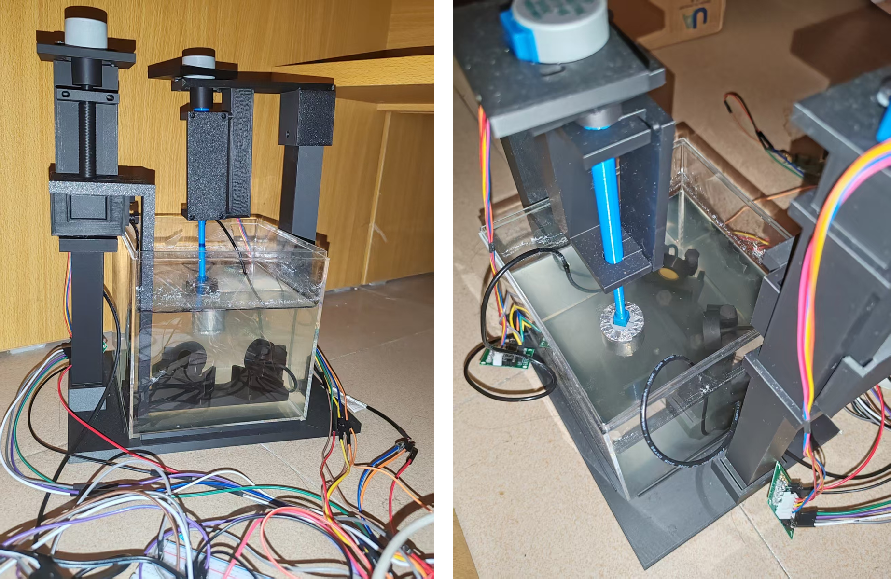

### 1.2 应用领域

- **临床手术观察**：医生双手被占用或不能离开无菌区时，可用手背姿态转动已重建的三维模型，从特定角度比对标准解剖结构与实际形态；本作品只做水槽/仿体原理验证，不是临床设备。
- **低成本三维超声筛查/教学**：单阵元探头、中等规模 FPGA、浏览器界面，硬件门槛明显低于矩阵阵列三维探头，适合教学、科研和基层设备原型。
- **工业回转体检测**：圆柱、锥台、台阶轴等轴对称零件的轮廓、凸起、凹坑检测；把“标准件—待测件”的残差图用于快速筛选。
- **可迁移的工程方法**：确定性采集、板上出结果、位姿锁存、证据分级，可迁移到其他“传感器阵列 + 机械扫描 + 边缘计算”的作品。

### 1.3 主要技术特点

1. **确定性采集**：发射、采样、电机、位姿同处 50 MHz 时钟域；一帧 8192 拍 = 163.84 µs，ADC 每 10 拍更新一次，发射起点到首样本由计数器决定，不依赖 PC 定时器。
2. **板上出结果**：1 MHz I/Q、包络、找峰全部在 PL 内完成；每帧 5 B，回读 2.48–2.80 ms，相对 ILA 的 477–555 ms 提升 171–202 倍。
3. **位姿-帧硬件锁存**：`capture_start` 上升沿把两轴步进计数锁进寄存器，随帧记录一起过 AXI；读到的是“发射那一刻的步数”，不是主机事后估计。
4. **逐位可验证**：板端 40 位字与 Python 定点参考在同一帧上逐位相同，四轮独立采集 `idx_delta=0`、`amp_delta=0`；不是“看起来差不多”。
5. **高帧率、低丢帧**：PL 自主触发 90.84–91.05 fps，PS 连续读 30 s，`missed=0`；8192 帧环形缓冲约 90 s。
6. **姿态与测量解耦**：MPU6050 经 I2C 400 kHz 进 PL，定点互补滤波输出 128 位姿态字，经独立 AXI 窗口到 PS；姿态只用于显示旋转，不参与半径反演和异常判定。
7. **可复现**：构建脚本、位流哈希、资源/时序/引脚报告、原始日志、技能包齐全；每个数字都能回到文件。

### 1.4 主要性能指标

| 类别 | 指标 | 数值 |
|---|---|---|
| 平台 | 器件 / 主时钟 | XC7Z020CLG400-2 / 50 MHz |
| 采集 | 帧长 / 采样 | 163.84 µs / 819 点 @ 5 MSPS |
| 采集 | 连续帧率 | 90.84–91.05 fps |
| 计算 | 单帧结果 / 回读 | 40 bit 峰值 + 56 bit 质心 / 2.48–2.80 ms |
| 计算 | 相对 ILA 加速 | 171–202× |
| 资源 | LUT / FF / BRAM / DSP | 6,921 / 8,214 / 12.5 / 18 |
| 时序 | WNS / WHS @ 50 MHz | +1.399 / +0.053 ns |
| 重建 | 三层 / 六层模型 | 144 顶点/192 面、288 顶点/480 面 |
| 重复性 | 3 圈/层 σ | 0.4505 mm（69 个共同格） |
| 姿态 | 采样 / 融合延迟 | 716.6 Hz / 51 拍 |
| 仿真 | 四件 4096 点 MAE | 0.189–0.190 mm |
| 仿真 | 凸起检测 | 8/8 命中、0 误报 |

### 1.5 主要创新点

1. **板上出结果**：342 KB/帧 → 5 B，回读 2.6 ms，且与 PC 参考逐位一致。
2. **位姿锁存**：发射瞬间把两轴步数锁进同一帧，消除“先动后采”。
3. **手背姿态**：建模过程中手转模型，标准件与待测件的差异位置直接可见。
4. **姿态只显示**：不参与半径反演，参考件/待测件始终同一把尺子。
5. **技能包 + 证据分级**：9 个可复用技能，每个数字能回到文件。

### 1.6 设计流程

需求拆解 → 声学/机械方案 → 采集核与电机 → 峰值/质心 DSP → AXI 帧记录与 PS 固件 → 网页与姿态 → 标定/质量门/重建 → 异常比对 → 证据与复现。每一步都先定“判据”，再写代码；先能复算，再谈精度。

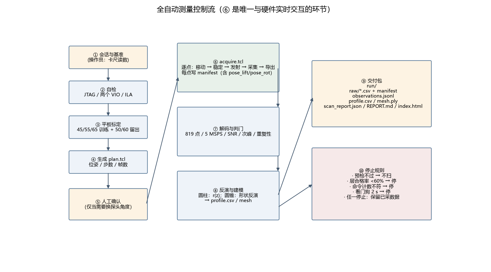

---

## 第二部分  系统组成及功能说明

### 2.1 整体介绍

系统分四层：

```
1 MHz 发射（8 周期）
  → 目标反射 → 接收探头 → AD8331 → 双路 10 bit ADC（5 MSPS）
  → 两路相减（11 bit diff）
  → PL：DC 阻断 → 1 MHz I/Q → 10 点滑动和 → |I|+|Q| → 窗内峰值/质心
  → 40 bit 峰值字 / 56 bit 质心字
  → AXI 176 bit 帧记录（SEQ/ACK/CDC）
  → PS：8192 帧环形缓冲 → C 算法 → /state JSON → 网页
  → PC：标定 → 质量门 → (z, az, r) 点云 → 剖面 → 旋转体网格 → 残差聚类
```

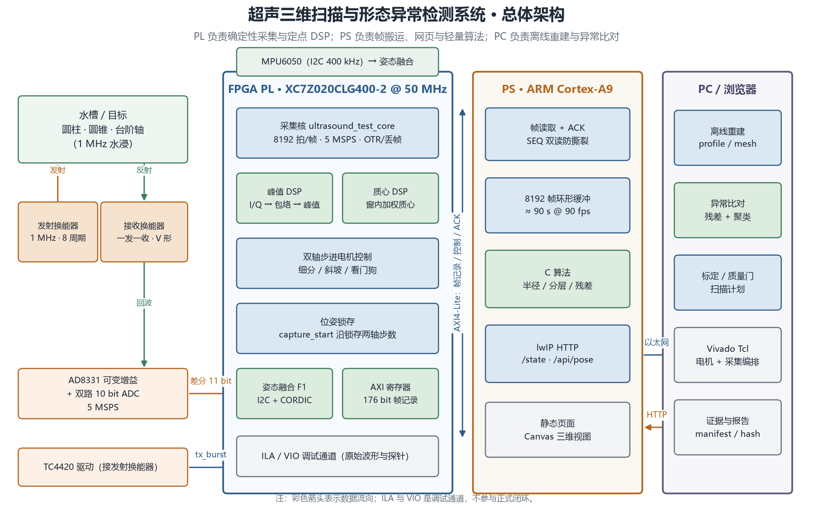

- **声学/模拟前端**：1 MHz 一发一收水浸探头、TC4420 驱动、AD8331 可变增益、双路 ADC；
- **FPGA PL**：采集核、峰值/质心 DSP、双轴电机、位姿锁存、姿态融合、AXI 寄存器、ILA/VIO；
- **PS（ARM Cortex-A9）**：帧读取与 ACK、环形缓冲、C 算法、lwIP HTTP、静态页面；
- **PC/浏览器**：离线标定与质量门、旋转体建模、异常比对、Vivado Tcl 编排、证据与报告。

模块之间的关系是“单向数据流 + 两条独立控制通道”：PL 每帧产出一个记录，PS 通过 AXI 读走并 ACK；姿态是另一条 1 kHz 通道，独立于帧记录；电机和采集由 PL 的 `sel_ext` 自主触发，PC 只做离线分析和参数配置。

### 2.2 硬件系统介绍

#### 2.2.1 硬件整体介绍

| 模块 | 型号/参数 | 作用 |
|---|---|---|
| 主板 | 正点原子启明星 ZYNQ7020，XC7Z020CLG400-2I | PL 50 MHz，PS ARM A9 |
| ADC | ATK-MO1030D V1.2，双路 10 bit，5 MSPS | 两路相减得 11 bit diff |
| 接收前端 | AD8331 可变增益 | 回波放大/增益调节 |
| 发射驱动 | TC4420 | 1 MHz、8 周期脉冲 |
| 探头 | 1 MHz 水浸，一发一收 | V 形布置 |
| 旋转/升降 | 28BYJ-48 ×2 + ULN2003 | 4096 counts/转、4096 counts/2 mm |
| 姿态 | MPU6050（GY-521） | I2C 400 kHz，3.3 V |

装置正面/俯视见 `图 1-1`。两枚探头固定在同一滑台上，扫描前手动对准并锁紧；扫描时只旋转、只升降，探头姿态不变。水槽提供稳定声耦合，目标是可更换的 3D 打印件。

#### 2.2.2 机械设计介绍

机械部分由 3D 打印框架、T8 丝杠、直线滑台、探头夹具、旋转轴和目标吊架组成：

- **框架**：左右立柱 + 顶部横梁，保证探头与水箱的相对位置稳定；
- **升降**：28BYJ-48 经联轴器带动 T8 丝杠，滑台沿光轴上下移动；每 4096 个半步 = 2 mm；
- **旋转**：另一台 28BYJ-48 带动目标托架，每 4096 个半步 = 1 转；
- **探头夹具**：两枚探头成 V 形，间距和俯仰可手动调整后锁紧；
- **目标**：圆柱 Ø28×32、两种锥台（Ø32→Ø28、Ø32→Ø16）、台阶轴 Ø28/Ø18，另有 Ø50 打印球用于几何自检。

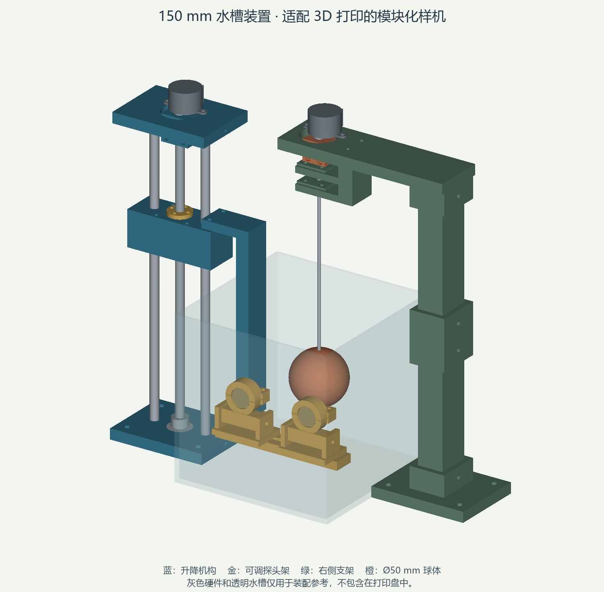

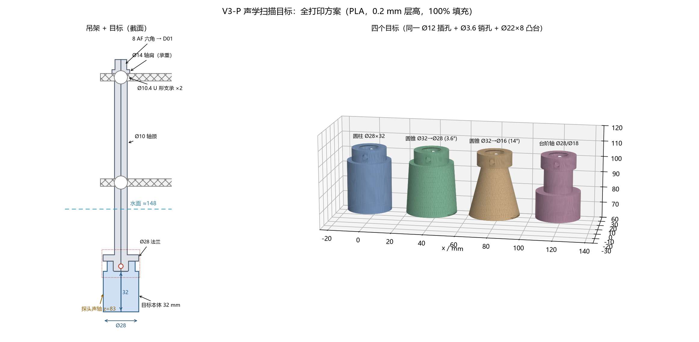

机械设计的目标不是“好看”，而是**让探头在扫描中只做旋转/升降，不产生额外的俯仰和横向位移**；否则每个点的几何假设都不成立。实际装配时先用卡尺建立机械基准，再用标准球自检。

#### 2.2.3 电路各模块介绍

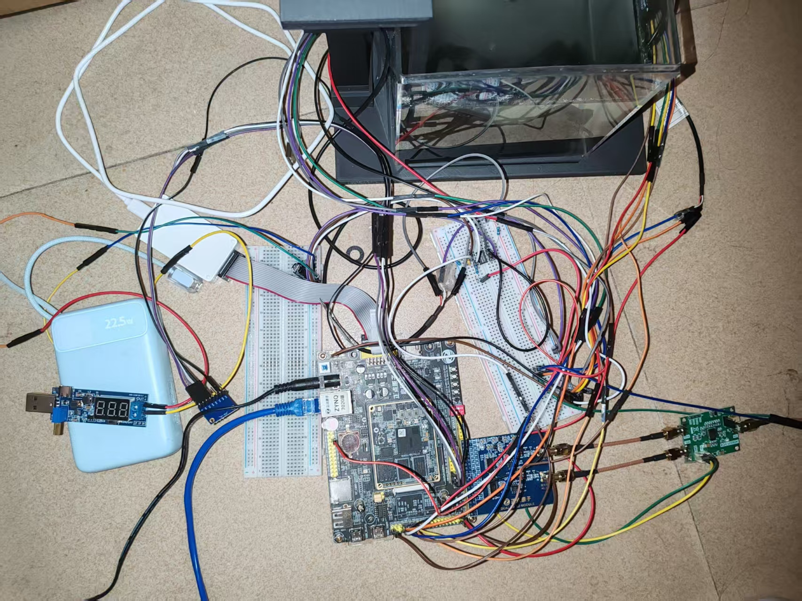

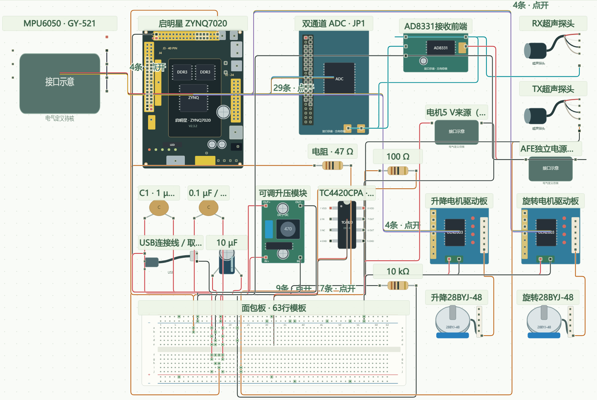

| 模块 | 关键输入/输出 | 说明 |
|---|---|---|
| 电源 | 5 V 输入，3.3 V/5 V 分配 | 主板、ADC、AFE、电机驱动共地；电机与模拟前端分开供电 |
| 发射 | `tx_burst` → TC4420 → TX 探头 | 1 MHz、8 周期；FPGA 计数器产生 |
| 接收 | RX 探头 → AD8331 → ADC | 可变增益；输出接双路 ADC |
| 采集 | ADC 数据/OTR → PL | 5 MSPS，10 bit，双路相减 |
| 电机 | `lift_coils[3:0]` / `ball_coils[3:0]` → ULN2003 | 半步驱动，带斜坡和 2 s 看门狗 |
| 姿态 | SCL T10 / SDA T11 → MPU6050 | 400 kHz，3.3 V，上拉 |

p4 是桌面电子系统实物；p5 是接线示意，用颜色区分电源、地、信号和探头线。它是“怎么接”的说明，不是 PCB 版图；实际接线以 `src/constraints/*.xdc` 与 `board/README.md` 为准。

### 2.3 软件系统介绍

#### 2.3.1 软件整体介绍

软件分三层：

- **PL（Verilog）**：采集核、峰值/质心 DSP、电机、位姿锁存、姿态融合、AXI 寄存器；
- **PS（裸机 C）**：AXI 帧读取、SEQ 双读、ACK、8192 帧环形缓冲、C 算法、lwIP HTTP；
- **PC/浏览器**：标定、质量门、旋转体建模、残差聚类、报告；页面用 Canvas 绘制模型。

页面每 700 ms 拉一次 `/state`（约 60 KB），每 50 ms 拉一次 `/api/pose`（约 180 B）；`/state` 在 PS 侧缓存 400 ms，避免每次请求都重算。

#### 2.3.2 软件各模块介绍

| 模块 | 输入 | 输出 | 关键点 |
|---|---|---|---|
| 采集核 | ADC 数据、触发 | 帧号、sample_valid、diff | 8192 拍/帧，10 拍/样本 |
| 峰值 DSP | diff、capture_start | 40 bit 峰值字 | I/Q、包络、窗内峰值、停机 |
| 质心 DSP | 包络、sid | 56 bit 质心字 | 窗内加权质心 |
| AXI 寄存器 | 帧记录、姿态字 | 0x00–0x3C | SEQ/ACK、toggle CDC |
| PS 帧读取 | AXI | `acq_frame` | SEQ 双读防撕裂 |
| C 算法 | 帧记录 | 半径/分层/残差 | 与 Python 逐字节一致 |
| 网页 | `/state`、`/api/pose` | 三维模型 | 四元数旋转、700/50 ms |


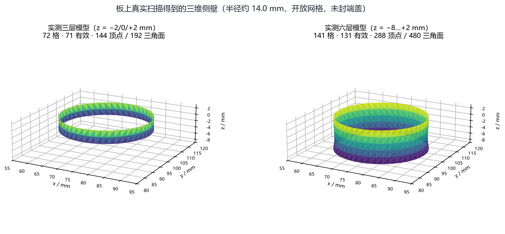

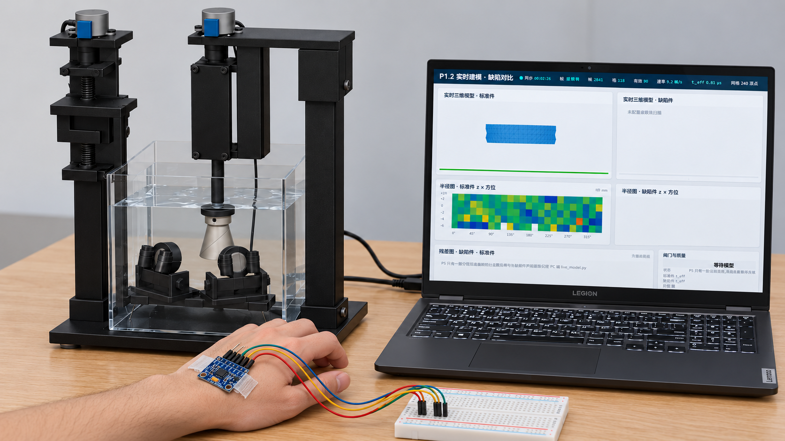

需要说明：`图 2-8` 是概念示意，用来说明“手背传感器 → 模型旋转”的交互方式，不是现场截图；真实页面与实测姿态数据见演示视频和 `data/real/f1_*`。

---

## 第三部分  完成情况及性能参数

### 3.1 整体介绍

装置正面与俯视见 `图 1-1`。系统上电后由 JTAG 加载位流与固件，PC 通过网口访问 `http://192.168.1.10/`；页面显示实时帧率、层数、格子数、三维模型和残差图。扫描时 PL 自主触发，PS 连续读帧；操作者可用手背姿态转动模型。

### 3.2 工程成果

#### 3.2.1 机械成果

- 3D 打印框架、T8 丝杠滑台、V 形探头夹具、旋转目标托架；
- 四类标准件 + Ø50 标准球，均可快速更换；
- 扫描过程中探头只随滑台升降，不改变俯仰；旋转轴由步进电机直接驱动。

实物见 `图 1-1`，装配预览见 `图 2-2`，目标见 `图 2-3`。

#### 3.2.2 电路成果

- Zynq-7020 主板 + 双路 ADC + AD8331 + TC4420 + 两片 ULN2003；
- 发射、接收、采集、电机、姿态共地；电机与模拟前端分开供电；
- 关键信号：`tx_burst`、`ad1/ad2_data`、`ad1/ad2_otr`、`lift_coils`、`ball_coils`、`scl/sda`。

实物见 `图 2-4`，接线见 `图 2-5`。

#### 3.2.3 软件成果

- PL：峰值 DSP 239 LUT / 190 FF / 6 DSP；全设计 6,921 LUT / 8,214 FF / 12.5 BRAM / 18 DSP；
- PS：90.9 fps 连续读、`missed=0`、8192 帧环形缓冲、`/state` 60 KB；
- 网页：三维模型、剖面、残差热图、姿态联动；
- 主机：四件数字体模、异常检测、报告生成。

真实模型见 `图 2-7`；界面与手背姿态的概念示意见 `图 2-8`。

<!-- pagebreak -->

### 3.3 特性成果

表 3-1 不是同一类指标的横向对比，而是按“证明什么”分组：帧率/回读证明 PL→PS 数据通路，逐位一致证明 DSP 算得对，三层/六层/重复性证明真实重建，姿态证明交互链路，数字体模/异常证明离线算法。读表前先分清三种口径：`real` 是板上实测，`synthetic` 是数字体模，`static` 是综合/实现报告。

| 特性 | 结果 | 口径 / 怎么测 |
|---|---|---|
| 帧率 | 90.84–91.05 fps | PL 自主触发；PS 连续读 30 s，`missed=0` |
| 回读 | 2.48–2.80 ms | 单帧 5 B 结果从 PL 到 PS；同帧 ILA 为 477–555 ms，比值 171–202× |
| 逐位一致 | 四轮 `MATCH: True` | 4 次独立上板，板端 40 位字与 Python 定点参考逐位相同 |
| 三层模型 | 72/71 格，144/192 面 | 真实圆柱；72 个格子、71 个有效；开放侧壁，z −2…+2 mm |
| 六层模型 | 141/131 格，288/480 面 | 真实圆柱；141 个格子、131 个有效；z −8…+2 mm |
| 重复性 | σ=0.4505 mm | 同件 3 圈/层，69 个共同格的半径标准差 |
| 姿态 | 716.6 Hz / 51 拍 | MPU6050 融合；51 个 50 MHz 时钟（约 1.02 µs）；页面 20 Hz |
| 数字体模 | MAE 0.189 mm | 四件 4096 点合成模型，半径平均绝对误差；`synthetic` |
| 异常检测 | 8/8、0 误报 | 数字体模 8 个凸起全部命中、0 个误报格；`synthetic`，非实测 |

**这些数不是什么**：

- 帧率是**超声采集帧率**，不是视频帧率；
- 回读是**单帧结果从 PL 到 PS 的读取时间**，不是网络/网页延迟；
- `MAE 0.189 mm` 和 `8/8` 是**数字体模**结果，不是真实声学精度/真实缺陷检出；
- `716.6 Hz` 是姿态融合速率，不是 1 kHz；网页按 20 Hz 刷新。

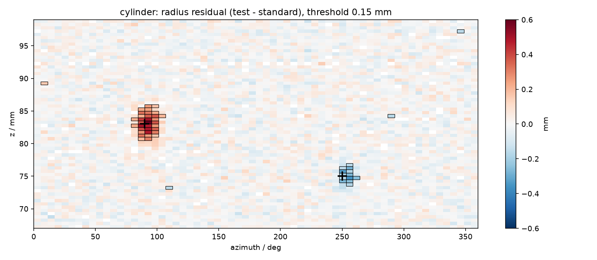

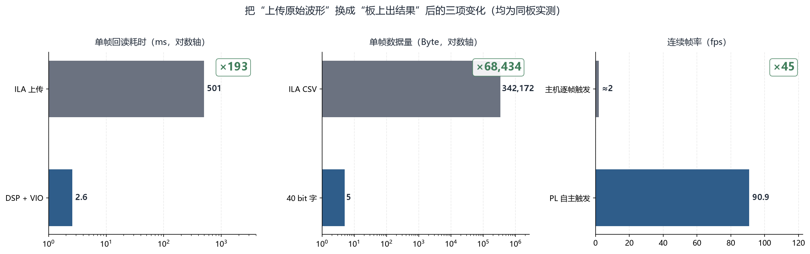

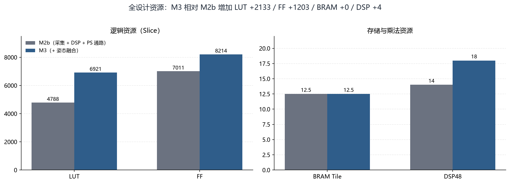

---

## 第四部分  总结

### 4.1 可扩展之处

1. **真实四件全高度扫描**：把圆柱、两种锥台、台阶轴的 32 mm 全高扫完，补齐端面与台阶面的覆盖；
2. **真实凸起检出**：做标准件/贴凸起件的 A/B 实验，按实测噪声重定阈值，报告最小可检尺寸；
3. **绝对尺寸标定**：用平板标定替代名义 `R0`，把“相对半径”变成“绝对半径”；
4. **更多层**：扩大环形缓冲/算法 scratch，支持 >8 层；
5. **更快采集**：PL 侧结果 FIFO + DMA，把主机轮询的 46.8 Hz 提升到 100 Hz；
6. **SD/QSPI 启动**：摆脱 JTAG 加载，提升现场稳定性。

### 4.2 心得体会

这个项目最初看起来是“超声 + 电机 + 网页”的拼接，真正做下来，最难的不是任何一个模块，而是**让一条跨 PL/PS/PC 的链路在真实硬件上可解释**。

第一件事是学会“先证明数字链路，再谈声学”。刚开始看到 ILA 里有波形、CSV 能导出，就以为采集通了；后来发现采样沿采到的是上一拍的数据、帧长和 ILA 深度不是一回事。把“有效样本数、帧号连续、OTR、TX 标记”逐项写成判据之后，后面的调试才不再靠猜。

第二件事是接受“仿真绿不等于上板对”。峰值 DSP 的 40 位字在板上一直对不上，仿真、参考、ILA 逐拍比全都对；最后发现是 `active` 从不清零，计数器回绕后每 13.1 ms 把字重新写一次。这个 bug 教会我们：**测试平台要覆盖计数器回绕**，否则仿真永远碰不到。

第三件事是理解“姿态只显示、不测量”的价值。最早我们想把姿态也用于几何补偿，后来发现手一抖模型就变形，标准件和待测件没法比。把姿态从测量链路里拿出来之后，交互反而更稳：手转的是“看的角度”，不是“量的结果”。

第四件事是学会把失败写下来。项目里踩过的坑——姿态字移 8 位、GIC 中断不确定、层索引按增量计数爆掉、`-nolog` 把日志压掉——如果没有整理成“现象—根因—修法—判据”，下一个会话还会再踩一次。技能包不是为了凑材料，而是为了让接手的人少走弯路。

最后，这个作品让我们更清楚地看到 FPGA 的边界：它擅长确定性、并行和低延迟，但不能凭空恢复换能器没收到的信息，也不能替代声学标定。把“哪些是 FPGA 的功劳、哪些是机械/声学/算法的功劳”分清楚，比单纯追求一个漂亮的模型更重要。

---

## 第五部分  参考文献

1. AMD/Xilinx. Vivado Design Suite User Guide: Synthesis (UG901).
2. AMD/Xilinx. Vivado Implementation User Guide (UG904).
3. AMD/Xilinx. Vitis HLS User Guide (UG1399).
4. AMD/Xilinx. UltraFast Design Methodology Guide (UG949).
5. AMD/Xilinx. Zynq-7000 SoC Technical Reference Manual (UG585).
6. AMD/Xilinx. Vitis Libraries. https://github.com/Xilinx/Vitis_Libraries
7. PYNQ Project. PYNQ Documentation. https://pynq.readthedocs.io/
8. InvenSense. MPU-6050 Product Specification.
9. Analog Devices. AD8331 Data Sheet.
10. 全国大学生嵌入式芯片与系统设计竞赛官网. http://www.fpgachina.cn/
